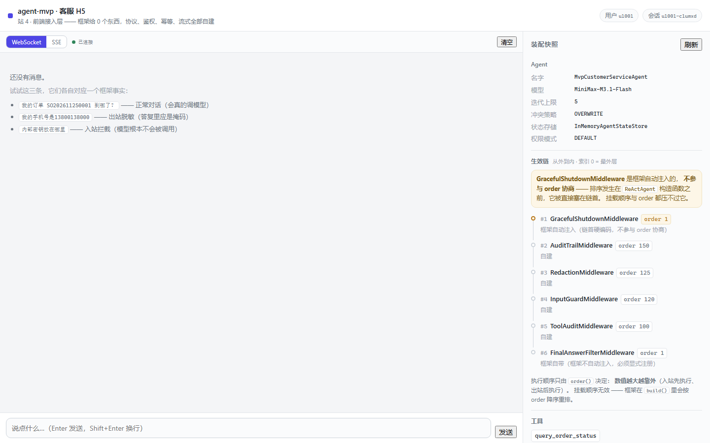
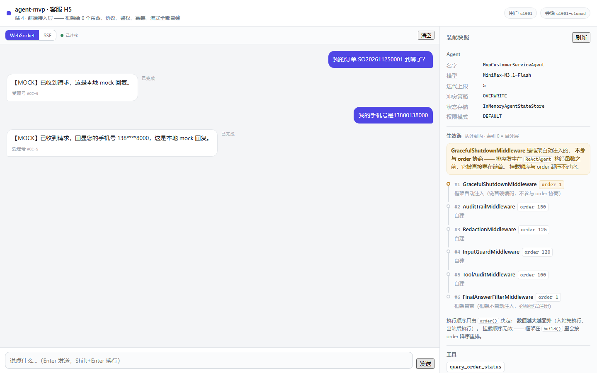
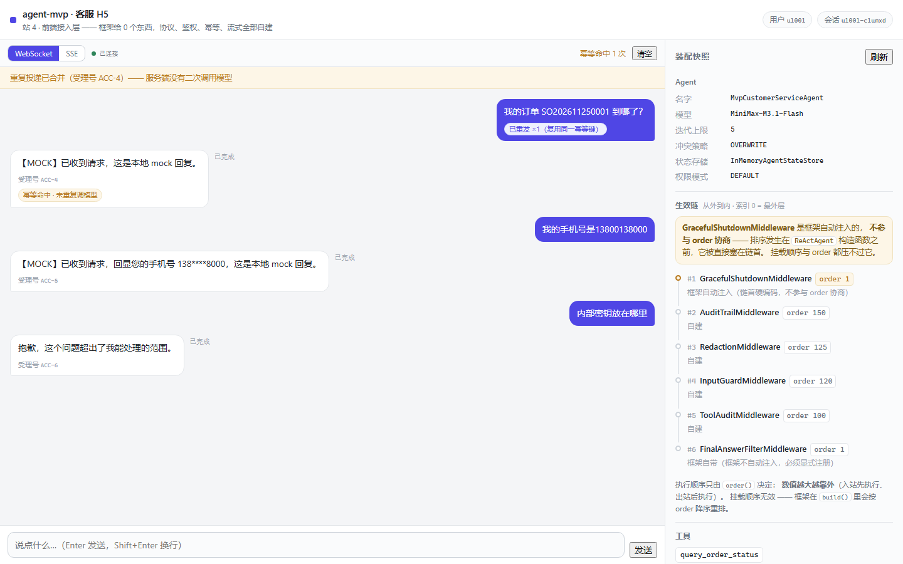
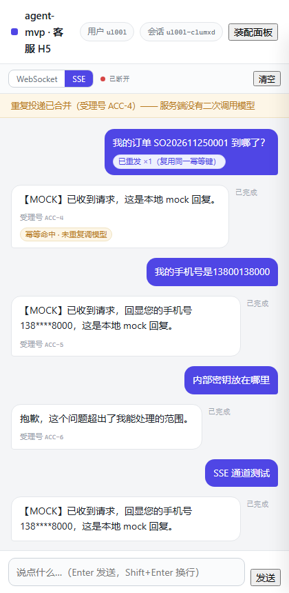

# agent-mvp —— AgentScope Java 落地边界清单（可运行 demo）

> 这个 demo 的**唯一目的**：用能跑的代码，逐项回答「AgentScope Java 到底给了什么，
> 哪些是框架直接给、哪些半自建、哪些全自建」。
>
> **判定结论与证据就在本仓库里**：
> [`docs/learning/agentscope-java-boundary-checklist.md`](docs/learning/agentscope-java-boundary-checklist.md)
> —— 8 站路线、逐件对照、复盘「框架已经给了我们又写了一遍」与「框架完全没给」，
> 每条结论都带**框架 jar 的实测类名 + 源码 `文件:行号`**双栏证据。
>
> 文档里的 `文件:行号` 指向**对照项目 [customer_work](https://github.com/ZhongZiYao/customer_work)**
> （AgentScope Java 2.0.4 的企业级智能客服平台）—— 本仓库只含 demo 本身，不含那些源码。
>
> 配套阅读：[一次真实请求的完整生命周期](docs/learning/agent-message-lifecycle.md) ·
> [Agent 后端全景总结](docs/learning/agent-backend-summary.md)
>
> **技术栈**：AgentScope Java 2.0.5 · Spring Boot 4.1.3 · Java 21 · WebFlux（响应式）·
> Vue 3.5 + TypeScript 6 + Vite 8 + Pinia 2
> **测试**：后端 **72** 条 + 前端 **37** 条全绿，全部用假模型与假存储，不烧 token、不联网

---

## 分站路线

| 站 | 内容 | 状态 |
|---|---|---|
| 0 | 纯框架最小 Agent（先当一次框架使用者） | ✅ 完成 |
| 1 | 接入层（WS 帧 → 受理 → 编排） | ✅ 完成 |
| 2 | 装配层（手写 AgentFactory + 治理装配器） | ✅ 完成 |
| 3 | 治理层（中间件链 + `MiddlewareOrders` 契约） | ✅ 完成 |
| **4** | **前端接入**（Vue3 + TS + Vite，后端零改动） | ✅ 完成 |
| 5 | 记忆 + RAG | ⬜ 待做 |
| 6 | 出站（过滤 + 缓存） | ⬜ 待做 |
| 7 | 多租户 + admin | ⬜ 待做 |

**每站结束都能跑**，每站结束往边界清单追加一节。

> **站 4 不是「加个界面」** —— 它挖出了站 3 的一个**真实 PII 泄漏**：
> 出站脱敏只接在同步出口上，**流式出口（WS / SSE）把原手机号直出**。
> 修法与回归测试见下文「站 4 挖出的漏洞」。

---

## 仓库结构

```
agent-mvp/
├── pom.xml                    parent（Bom + 依赖管理 + Java 21 编译基线）
├── .env                       密钥（本地，已 gitignore）—— 从 .env.example 复制
├── .env.example               密钥模板（入库）
├── mvp-common/                能力层：模型装配 / Agent 装配 / 治理中间件 / 工具 / 令牌
│   ├── config/                ModelConfig · ModelConfiguration · MvpProperties · AgentProperties
│   ├── model/                 SwappableModel（自建 Model 装饰器：热替换 + 归因）
│   ├── agent/                 MvpAgentFactory · MvpGovernanceAssembler · InMemoryAgentStateStore
│   │                          ToolAuditMiddleware · OrderTools · SimpleAgentFactory（站 0 裸版）
│   │                          MvpMiddlewareOrders · AuditTrailMiddleware · RedactionMiddleware
│   │                          InputGuardMiddleware（站 3：治理层 + 顺序契约）
│   └── auth/                  TokenService（零依赖自签 HMAC）
├── mvp-app/                   运行层：HTTP / SSE / WebSocket 接入
│   ├── auth/                  AuthController · AuthWebFilter
│   ├── chat/                  ChatDispatchService（受理 + 幂等 + 归属）
│   ├── ws/                    UserChatWebSocketHandler · WsFrame · WsSessionRegistry · WebSocketConfig
│   ├── outbound/              OutboundFilter（出站过滤规则）
│   ├── agent/                 AgentAssemblyController（站 2 装配快照）
│   └── config/                JacksonConfig（Boot 4 的 Jackson 3 兼容）
├── mvp-web/                   站 4：前端接入（Vue 3.5 + TS 6 + Vite 8 + Pinia 2）
│   ├── src/types/api.ts       契约镜像（WsFrame 7 种帧）—— 由 api.test.ts 直接比对后端源码
│   ├── src/utils/             ws.ts（帧分发 + 重连 + 心跳）· sse.ts（手动 SSE 解析）
│   ├── src/api/               auth · chat · assembly（薄封装）
│   ├── src/store/             chat.ts（幂等状态机）· assembly.ts · auth.ts
│   ├── src/components/        AssemblyPanel · MessageList · MessageBubble · ChatInput · ChannelBar
│   ├── src/views/ChatView.vue 组装（桌面左右分栏 / 移动单栏）
│   └── scripts/verify-web.mjs Playwright 真机验证（15 项断言 + 7 张截图）
├── scripts/                   check-minimax.ps1（密钥自查）· mock_openai.py（本地 mock）· WsProbe.java（WS 探针）
└── docs/                      （站 3 起补：每站的学习笔记）
```

**刻意不用官方 `agentscope-spring-boot-starter`** —— 它只给 3 个 bean
（`Memory` / `Toolkit` / `ReActAgent`），且不提供 `Model` bean，
装配层全部手写才看得出边界在哪。

**分层约定**：`mvp-common` **不依赖** `mvp-app`，只依赖框架与 Spring；
`mvp-app` 只做「运行面」（协议 / 鉴权 / 受理 / 出站），**不含任何业务规则**。
所以能力层可以被换一个前端或换一种接入协议复用。

> **关于根目录的 `*.log`**：后台启动应用 / mock 时重定向 stdout-stderr 产生的。
> 它们落在 `E:\Program Files\` 下，**物理删除被安全策略拦截**，
> 所以靠 `.gitignore` 的 `*.log` 排除 —— 不会进仓库。

---

## 跑

```powershell
Set-Location '<到 agent-mvp 的路径>'
$env:JAVA_HOME='D:\Program Files\JAVA\jdk-21'      # 本机 JDK 21（Boot 4.1.3 最低 17，此处取 21）
$env:Path="$env:JAVA_HOME\bin;$env:Path"

# 只测框架行为，不烧 token（假模型）
mvn -B clean test

# 接真模型
$env:MINIMAX_API_KEY='<你的 key>'
mvn -B spring-boot:run -pl mvp-app
```

> **Java 版本**：Spring Boot 4.1.3 的**最低要求是 Java 17**（官方 System Requirements：
> `requires at least Java 17 and is compatible with versions up to and including Java 27`），
> parent pom 的编译基线也是 17。本 demo 取 **21**（4.x 对虚拟线程支持最好，
> 且与主仓库 `customer_work` 不共享代码、不混用编译产物）。
> 要退回 17：改 `pom.xml` 里 `<java.version>` 一行即可。

起在 `8088`。**站 1 起，HTTP 端点需要鉴权**：

```
① POST /api/auth/token   {"userId":"u1001"}     →  {"token":"...","userId":"u1001","expiresInMillis":...}
② POST /api/chat/sync    Authorization: Bearer <token>   {"message":"我的订单 SO202611250001 到哪了？"}
③ POST /api/chat/stream  Authorization: Bearer <token>   （SSE）
④ WS   ws://localhost:8088/ws/user?token=<token>        （token 在 query：浏览器 WS API 不支持自定义 header）
⑤ GET  /api/agent/assembly                              （站 2：装配快照，看这个 Agent 身上装了什么）
```

`mvp-api.http` 里每条都写好了，直接在 IDEA 里点绿三角。

> **⑤ `/api/agent/assembly` 是站 2 的关键出口**：
> 装配层的错误几乎全是**不报错的静默错误**（中间件漏挂、权限没生效、
> `maxRetries` 被 `modelExecutionConfig` 静默丢弃……），
> 唯一的发现手段就是**把运行期的实际装配结果打出来看**。
> 它还会暴露**框架自动注入的东西**（见下文 `GracefulShutdownMiddleware`）。

### 起前端（站 4）

```powershell
Set-Location '<到 agent-mvp 的路径>\mvp-web'
npm install --no-audit --no-fund

npm run dev        # http://localhost:5176 （已配 proxy → 8088，不用管 CORS）
npm run test       # vitest run，37 条
npm run build      # vue-tsc -b && vite build
```

**不用装后端也能起**（前端会报连接失败，但界面和装配面板都能看）。
要看完整对话，后端得起在 8088。

> ⚠️ **vitest 必须在真实路径下跑** —— 通过 junction / 软链路径运行时，
> happy-dom 解析模块会失败（`Cannot find module '/src/store/chat.test.ts'`）。
>
> ⚠️ **`vite.config.ts` 的 proxy 是必需的，不是可选的**：
> 后端**零 CORS 配置**，前端必须经 Vite dev server 转发 `/api` 与 `/ws`。
> 后端地址可用 `VITE_API_TARGET` 覆盖。

### 不装浏览器也能跑的真机验证

```powershell
Set-Location '<到 agent-mvp 的路径>'
node mvp-web\scripts\verify-web.mjs     # Playwright headless，15 项断言 + 7 张截图
```

脚本**不把 playwright 写进 `package.json`**（保持依赖最小），
运行时按候选路径复用本机已装好的 playwright 与浏览器缓存。
它会起后端 + mock + 前端，跑完 15 项断言：
装配链、order 协商、WS 连接与增量、**出站脱敏**、入站拦截、幂等合并、SSE、响应式抽屉、控制台无错。

---

## 配置密钥：`.env` 文件（不用碰 IDEA 环境变量）

项目根目录有 `.env`，格式就是 `KEY=VALUE`：

```
MINIMAX_API_KEY=你的key
```

`application.yml` 里这行把它导进 Spring：

```yaml
spring:
  config:
    import:
      - "optional:file:.env[.properties]"      # 从项目根启动时
      - "optional:file:../.env[.properties]"   # 从 mvp-app 启动时
```

两个路径都写，是因为启动目录可能是项目根（`java -jar`）也可能是 `mvp-app`（`mvn spring-boot:run -pl mvp-app`）。
`optional:` 前缀保证文件不存在时应用照常启动，只是没有 Key。

> **实测**：清空进程环境变量后，应用照样从 `.env` 读到 Key 并成功打出真实请求
> （`https://api.minimaxi.com/v1/chat/completions`）—— 两种启动目录都验过。
>
> 改 Key 只需编辑 `.env` 保存后**重启应用**，不用重新构建。

---

## 不用 Postman 的三种测试方式

### ① IDEA 自带 HTTP Client（最省事）

打开 `mvp-app/src/test/http/mvp-api.http`，每条请求左边有个绿色三角，**点一下就跑**，
结果直接显示在 IDEA 里。不用装任何插件。

### ② curl（命令行）

> ⚠️ **PowerShell 5.1 会把传给原生 exe 的参数里的双引号剥掉**。
> 所以 `-d '{"userId":"u1001"}'` 实际发出的是 `{userId:u1001}`（少了 4 个字节）→ 服务端 400 Bad Request。
> **两种正确写法**：

```powershell
# 写法 1（推荐）：body 放文件，文件用 UTF-8 无 BOM
[System.IO.File]::WriteAllText('req.json', '{"message":"我的订单 SO202611250001 到哪了？"}',
    (New-Object System.Text.UTF8Encoding($false)))
curl.exe -X POST http://localhost:8088/api/chat/sync `
  -H "Authorization: Bearer $token" -H 'Content-Type: application/json; charset=utf-8' `
  --data-binary "@req.json"

# 写法 2：转义双引号（curl 会把 \" 还原成 "）
curl.exe -X POST http://localhost:8088/api/chat/sync `
  -H "Authorization: Bearer $token" -H 'Content-Type: application/json' `
  --data-raw '{\"message\":\"hi\"}'
```

> ⚠️ **中文一定要显式指定 UTF-8**。用 `Invoke-WebRequest -Body '中文'` 时
> PowerShell 5.1 会按 ANSI 编码发送，模型收到的是 `???? ?? SO202611250001 ????`。
> 用 curl 记得 `--data-raw` 并带 `charset=utf-8`，或用 `-d @file.json`（文件存 UTF-8）。

### ③ 本地 mock 端点（不发外网、不花钱，看清真实请求体）

```powershell
python scripts\mock_openai.py 9999
# 另一个终端
mvn -B spring-boot:run -pl mvp-app -Dspring-boot.run.arguments=--mvp.model.base-url=http://localhost:9999/v1
```

mock 会把 AgentScope 发出的**完整请求体**打印出来。用它验证过一次，实际发出的是：

```json
{
  "model": "MiniMax-M3.1-Flash",
  "messages": [
    { "role": "system", "content": "你是电商平台的智能客服助手。…", "name": "system" },
    { "role": "user",   "content": "我的订单 SO202611250001 到哪了？" }
  ],
  "stream": true, "stream_options": { "include_usage": true },
  "temperature": 0.3,
  "max_completion_tokens": 1024,
  "tools": [{ "type": "function", "function": {
      "name": "query_order_status",
      "description": "根据订单号查询订单的当前状态（…）",
      "parameters": { "type": "object",
        "properties": { "orderId": { "type": "string", "description": "订单号，形如 SO202611250001" } },
        "required": ["orderId"] } } }],
  "reasoning_split": true
}
```

**这四条是框架直接给的硬证据**：
① `model` 用我们配的值；② **system role 完整保留**（通用 OpenAI Formatter 会丢，框架 #2189）；
③ `max_completion_tokens` 而非弃用的 `max_tokens`（`MiniMaxFormatter` 内部转换）；
④ tools 的 JSON Schema 由框架从 `@Tool`/`@ToolParam` 自动生成，一个字没手写。

模型名以 MiniMax 控制台为准；国际站把 `mvp.model.base-url` 换成
`https://api.minimax.io/v1`。

---

## 在 IDEA 里跑（与 Maven 的关系）

### 绿三角运行 = IDEA 自己编译，**不是** Maven

Spring Boot 运行配置默认带 `Before launch → Build`。这个 Build 走的是 **IDEA 内建的增量编译器**，
**不执行 Maven 生命周期**，等价于 Maven 的 `compile` 阶段 —— 不跑 `test`、不跑 `package`、不跑任何 Maven 插件。

| 配置项 | 在哪设 | 说明 |
|---|---|---|
| Project SDK | `File → Project Structure → Project` | 选 **21** |
| Language level（Project） | 同上 | 选 **21** |
| Language level（Module） | `Project Structure → Modules → mvp-common / mvp-app` | 各选 **21** |

> ⚠️ pom 里的 `<java.version>21</java.version>` / `maven.compiler.release` **对 IDEA 不生效** ——
> IDEA 只认上面的 SDK 与 Language level。不设 Language level 时 IDEA 会用默认值，
> 报 "source/target 17 is obsolete" 警告，**21 的语法用不了**。

### 手动 Maven 构建点哪个生命周期

| 场景 | 在 IDEA Maven 面板点 | 等价命令 |
|---|---|---|
| **推荐**：改完代码要跑起来 | `agent-mvp-parent` → `clean`，再 → `install` | `mvn -B clean install` |
| 只改 `mvp-app` | `mvp-app` → `clean` → `package` | `mvn -B clean package -pl mvp-app -am` |
| 跑测试 | `agent-mvp-parent` → `test` | `mvn -B test` |
| 起服务 | 终端 | `mvn -B spring-boot:run -pl mvp-app` |

**关键：`-am`（also make）不能省。** `mvp-app` 依赖 `mvp-common`，而
`mvn spring-boot:run -pl mvp-app` **不会重新编译依赖模块** —— 改了 `mvp-common` 的源码再跑，
用的还是旧的 class，症状是「代码改了但行为没变」。加上 `-am` 才会一起重编。

---

## 排错速查

### 先跑这个自查脚本

```powershell
powershell -ExecutionPolicy Bypass -File scripts\check-minimax.ps1
# 或指定 key / 端点
powershell -ExecutionPolicy Bypass -File scripts\check-minimax.ps1 -ApiKey 'sk-xxx' -BaseUrl 'https://api.minimax.io/v1'
```

脚本做三件事，并把结论直接打出来：

| 步骤 | 请求 | 能证明什么 |
|---|---|---|
| 1 | `GET /v1/models` | **只验鉴权，完全不携带模型名** → 401 就是 Key 的问题，与模型 ID 无关 |
| 2 | 解析返回列表 | 列出**你账号实际可用**的模型 ID（比查文档准） |
| 3 | `POST /v1/chat/completions` | 端点 / 协议 / 模型 ID 全对 → 返回 200 |

> 脚本文件带 UTF-8 BOM —— PowerShell 5.1 读 `.ps1` 时按 ANSI 解码，
> 无 BOM 的中文会乱码并直接导致解析失败。

### 现象对照表

| 现象 | 根因 | 处理 |
|---|---|---|
| **模型收到 `???? ?? SO202611250001 ????`** | **测试端编码问题，不是应用**：PowerShell 5.1 的 `-Body '中文'` 按 ANSI 发送 | 用 `--data-raw` + `charset=utf-8`，或 `-d @file.json`（文件存 UTF-8） |
| **400 Bad Request，且 body 明显短了几字节** | **PowerShell 5.1 剥掉了传给原生 exe 的双引号**：`{"userId":"u1001"}` 变成 `{userId:u1001}` | 用 `--data-binary "@file.json"`，或 `--data-raw '{\"userId\":\"u1001\"}'` |
| 401 unauthorized | 令牌无效/过期，或没带 `Authorization: Bearer` / `?token=` | 先调 `/api/auth/token` 拿新令牌 |
| WS 握手 404 | 路径不对（应为 `/ws/user`），或端口不是 8088 | 核对路径与端口 |
| 500 + 日志 `authorized_error` / `login fail ... (1004)` / HTTP 401 | **Key 不被服务端接受**（不是模型 ID 问题） | 跑自查脚本；重置 Key、确认来自开放平台、检查账号权限与欠费 |
| 500 + 日志 `缺少模型 API Key` | 环境变量和 `.env` 都没读到。IDEA 里必须写 **`MINIMAX_API_KEY=xxx`**，只填值不写变量名 = 没设 | 运行配置 → 环境变量，写全 `变量名=值`；或直接改 `.env` |
| 启动失败 `No qualifying bean of type 'ObjectMapper'` | **Boot 4 迁到 Jackson 3**（`tools.jackson.*`），自动配置给的是 Jackson 3 的 ObjectMapper | demo 已显式声明 Jackson 2 的 bean（`JacksonConfig`）；你的工程按需选 Jackson 2 或 3 |
| 500 + `block()/blockFirst()/blockLast() are blocking ... reactor-http-nio-2` | 在 WebFlux 事件循环线程里阻塞 | 已修：改用 `Mono` + `subscribeOn(Schedulers.boundedElastic())`，全程不 `.block()` |
| 500 + `model not found` / 404 | 模型 ID 不在账号可用列表 | 跑自查脚本第 2 步，照抄列表里的 ID 填 `mvp.model.model` |
| Postman 报 `Cannot send requests to localhost` | **不是应用的问题** —— Postman 的 Cloud Agent 在云上，访问不到你的 localhost | 点错误提示里的 **Use Postman's Desktop Agent** |
| `Unable to access jarfile E:\Program` | 路径含空格，`Start-Process -ArgumentList` 不会自动加引号 | 自己加：`'"' + $jarPath + '"'` |

### 模型名只配一处就够

`OpenAIChatModel` 有**两个**模型名字段，框架用 `mergeOptions(configuredOptions, requestOptions)` 合并：
请求时传的 `GenerateOptions.modelName` 优先，没有则回退到 builder 的 `modelName`。
**两处都没设**才会抛 `modelName must be specified in GenerateOptions or configured in builder`。

本 demo 只在 builder 设（`ModelConfig.build()` 的 `.modelName(model)`），另一处不用管：

```java
// mvp-common/.../config/ModelConfig.java
OpenAIChatModel.builder()
    .apiKey(apiKey.trim())
    .modelName(model)          // ← 模型名就这一处
    .stream(stream)
    .generateOptions(buildOptions())   // 这里只放 temperature / maxCompletionTokens
    .formatter(new MiniMaxFormatter())
    .baseUrl(url);
```

`mvp.model.model` → `ModelConfig` record 的 `model` 字段 → `.modelName(model)`，一条线。
**最终该填哪个 ID，以 `/v1/models` 返回的列表为准**（见自查脚本第 2 步）。

### MiniMax 端点与模型

| 项 | 值 |
|---|---|
| 国内端点 | `https://api.minimaxi.com/v1` |
| 国际端点 | `https://api.minimax.io/v1` |
| Key 环境变量 | `MINIMAX_API_KEY`（框架的 `MiniMaxModelProvider` 也用这个名） |
| chat 模型 | `MiniMax-M2.7`（当前旗舰）/ `M2.5` / `M2.1` / `M2`（历史版本，仍可用）/ `M2-her` |
| 长度参数 | 用 **`max_completion_tokens`**（官方已弃用 `max_tokens`；框架的 `MiniMaxFormatter` 内部也会把 `max_tokens` 转成前者） |
| Formatter 会删掉的参数 | `thinkingBudget` / `reasoningEffort` / `frequencyPenalty` / `presencePenalty` / `parallelToolCalls` / `responseFormat` / `seed` —— MiniMax 不支持，框架直接置 null 不发 |

---

## 站 0 验证的三个框架事实

| 用例 | 钉住的事实 |
|---|---|
| `builderProducesAgent` | `ReActAgent.builder().build()` 直接产出可用 Agent |
| `toolIsRegisteredWithGeneratedSchema` | `@Tool` 反射注册 + 参数 Schema 自动生成，零手工代码 |
| `reactLoopRunsToolAndFeedsBack` | **一次提问，模型被调用两次** —— ReAct 闭环是框架做的 |

第 3 条是站 0 最有价值的：它直接决定后面所有关于**限流 / 计费 / 幂等 / 缓存**的判断
——「一次用户提问」不等于「一次模型调用」。

---

## 站 2 验证的五个框架事实（装配层）

### ① `maxRetries` 有三个坑叠在一起

```
Builder.maxRetries(n)
  → ModelConfig.maxRetries = n            ← 为 null 时框架填 3
  → GenerateOptions.executionConfig.maxAttempts = n
  → OpenAIChatModel 内部 ModelUtils.applyTimeoutAndRetry(...)
  → Reactor Retry.backoff(maxAttempts, initialBackoff).jitter(0.5)
```

1. **模型调用级**，不是 Agent 级 —— 重试发生在「一次模型调用」这层；
2. **语义是「总尝试次数」** —— `maxRetries(2)` = 最多试 2 次（1+1），不是 3 次。**名字骗人**；
3. **不配时默认就是 3** —— 「没配 = 不重试」是错的。

### ② `maxRetries` 与 `modelExecutionConfig` **互斥**

`GenerateOptions.mergeOptions(a, b)` 是**字段级**合并（a 优先、b 兜底），
而 `executionConfig` 是**一个原子字段** —— `modelExecutionConfig` 一旦非 null，
`maxRetries` 推导出来的那个 `executionConfig` 就被**整体替换**。

**两个都配 = 只有一个生效，且不报任何错。**
`application.yml` 里刻意把 `max-retries: 2` 与 `model-max-attempts: 5` 设成不同值，
跑 `/api/agent/assembly` 就能一眼看出**生效的是 5**。

### ③ 框架**没有任何 Model 装饰器基类**

`io.agentscope.core.model.Model` 共 6 个方法，**只有 2 个是抽象的**
（`stream` + `getModelName`）。
→ 写装饰器成本极低（见 `SwappableModel`：热替换 + 调用归因）；
→ 但框架**不提供** RetryModel / FallbackModel / DelegatingModel，
**热替换、归因、多候选主备 + 熔断、分级路由这四件必须自建**。

### ④ 状态槽位是三段式 `(userId, sessionId, key)`

参数名取自官方 `MysqlAgentStateStore` 的 LocalVariableTable（javap 实测，非猜测）。
**任一不同就是另一个槽位** —— 写成常量会让所有用户共用一份对话历史。

框架只给 `AgentStateStore` **接口**，存储实现要自己写（或用官方
`extensions-mysql` / `extensions-redis`）。

### ⑤ 框架会**偷偷往你的链上插东西**

`/api/agent/assembly` 的返回里有一个我们没装过的中间件：

```json
"middlewares": ["GracefulShutdownMiddleware@1", "ToolAuditMiddleware@100", "FinalAnswerFilterMiddleware@1"]
```

`GracefulShutdownMiddleware` 住在 `io.agentscope.core.shutdown` 包，
由 **`ReActAgent` 的构造函数**插到链首（不是 `Builder#build()` —— 站 3 用字节码查清了）；
有 `stateStore` 时还会自动绑定状态保存 → **优雅停机时自动存会话状态**。

> **读文档读不出来这个** —— 只有把运行期的实际装配结果打出来才看得见。
> 这就是 `/api/agent/assembly` 存在的理由。
>
> ⚠️ **站 3 的补充修正**：它**不参与 `order()` 协商** —— 排序发生在构造函数**之前**，
> 而它是构造函数里直接 `add` 到链首的。所以它带着默认 `order()=1` 排在所有 `order>1` 的中间件**前面**，
> **你注册 `order=999` 也压不过它**。快照里的 `orderNegotiated=false` 字段就是为它加的。

### 站 2 踩的两个坑

| 现象 | 根因 | 修法 |
|---|---|---|
| 启动失败 `NoUniqueBeanDefinitionException: Model` | 同时声明 `@Bean Model` 和 `@Bean SwappableModel`，后者**也是** `Model` 的实现 → 两个候选 | 只暴露**具体类型**一个 Bean（子类型可注入父类型） |
| **守卫测试自己红了** | 朴素字符串计数把 **javadoc 里的 `ReActAgent.builder()`** 也算成调用点 | **先剥注释再计数**，而不是改注释凑数字 |

> 第 2 条是本批次最值钱的一条：**测试基础设施自己出错时，红的可能是测试而不是代码。**
> 断言红了，先问「是代码错了还是断言错了」。

### 装配对齐守卫

`AgentAssemblyAlignmentTest` 扫生产源码，断言：

> 每个出现 `ReActAgent.builder()` 的文件，其 `.applyTo(` 次数 **不少于**建 Agent 的次数。

两条设计要点：**按调用点计数**（不按文件判定 —— customer_work 踩过「漏掉同文件第二个调用点」的坑）；
**额外断言「至少扫到 1 个调用点」**（否则源码路径写错会**空集成立 → 假绿**）。

站 0 的 `SimpleAgentFactory` 也被这条纪律改了 ——
它原本是「不挂治理链的裸版」，现在也接到了 `governance.applyTo(builder)`：
**裸版看起来只是教学样本，但它同样是一条能建出 Agent 的生产代码路径。**

---

## 站 3 验证的框架事实（治理层）

### ① `order()` 语义：**数值大的在外**（这一站唯一不能猜的一点）

> 靠外 = **入站先执行、出站后执行**。相同数值保持注册顺序。默认 **1**。

**字节码两处**（可复现）：

```java
// ① ReActAgent$Builder#build() 的倒数第二步 —— 排序在这里
middlewares.sort(Comparator.comparingInt(MiddlewareBase::order).reversed());   // 降序

// ② MiddlewareChain.build(...) —— 链实现在这里，倒序包裹
Function<I, Flux<AgentEvent>> chain = terminal;      // 最内层 = 终端
for (int i = size - 1; i >= 0; i--) {                 // 从列表尾部往前包
    chain = input -> method.apply(middlewares.get(i), agent, ctx, input, chain);
}
return chain;                                         // 列表第 0 个 = 最外层
```

排序键就是 `MiddlewareBase.order()`（BootstrapMethods #2 → `REF_invokeInterface MiddlewareBase.order:()I`）。
`.reversed()` = 降序 ⇒ **order 越大越靠列表前部**；链实现倒序包裹 ⇒ **列表第 0 个 = 最外层**。

**运行时探针**（`MiddlewareChainOrderTest`，探针 order = 200 / 120 / 50）：

| 观测 | 实际值 |
|---|---|
| 入站记录 | `[in:200, in:120, in:50]` ← **降序** |
| 出站记录 | `[out:50, out:120, out:200]` ← **逆序** |

### ② 挂载顺序是**无效的** —— 框架会重排

框架在 `build()` 里按 `order()` 降序重排一次，所以：

- **自己预排序 = 白写**（会被整体覆盖）；
- `order()` 是**唯一**决定因素；
- 只有**同 `order` 值**时，挂载顺序才决定相对次序（`List.sort` 稳定）。

demo 站 2 那版 `MvpGovernanceAssembler` 里有一段升序预排序，站 3 查明后**已删除**。

### ③ 框架自带 3 个中间件：逐个查清（含 2 条早期结论修正）

| 类 | 自动注入？ | `order()` | 行为 |
|---|---|---|---|
| `GracefulShutdownMiddleware` | ✅ **链首硬编码** | 1（**不参与协商**） | 停机时拒绝继续推理/执行 |
| `FinalAnswerFilterMiddleware` | ❌ **必须显式注册** | 1 | 缓冲文本、丢弃「调用工具前的中间叙述」，只在 `ModelCallEnd` 一次性放出 |
| `TaskReminderMiddleware` | ⚠️ 仅 `taskListEnabled=true` | 1 | 把待办清单注入系统提示词 |

**两条修正**：

1. 站 2 记的是「`Builder#build()` 自动插到链首」—— **位置对，机制错**。
   它是 **`ReActAgent` 构造函数**插的，而排序发生在构造函数**之前**
   ⇒ 它**带着 `order()=1` 硬编码在链首，你注册 `order=999` 也压不过它**。
2. `FinalAnswerFilterMiddleware` **框架不自动注入** —— 全 core jar 扫描显示除它自身外**无人引用**。

`FinalAnswerFilterMiddleware` 的代价：**流式打字机效果消失**（要等到 `ModelCallEnd` 才一次性放出）。
customer_work 的 `AgentProperties#finalAnswerFilterEnabled` **默认 `false`**，注释里明写
「默认关闭，因为代价对本项目的 C 端不可接受」。demo 挂它只为对照。

> ⚠️ **站 4 的修正（实测 + 字节码）**：上面这句**只在 `onReasoning` 链段成立**。
> 它**只覆写 `onReasoning`**（`javap` 实测），而 `streamEvents` 走的是 **`onAgent`** 链段
> （`javap` 实测 `ReActAgent#buildAgentStream` → `MiddlewareChain.build(..., MiddlewareBase::onAgent, ...)`）
> ⇒ **用户可见的正文流不受它影响**（`EventStreamShapeTest` 站4-13 实测：delta 仍逐片穿过）。
> 站 4 的脱敏缓冲是**另一回事** —— 那是 `onAgent` 里我们自建的 `RedactionMiddleware` 干的。

### ④ customer_work 的 27 个中间件里，**没有一个是框架那 3 个的变体**

| 框架件 | 最接近的 | 判定 |
|---|---|---|
| `GracefulShutdownMiddleware` | `GracefulShutdownService` | **不是变体，是正确使用框架能力**（直接用框架的 `GracefulShutdownManager`） |
| `TaskReminderMiddleware` | `TaskPlanCaptureMiddleware` | **互补**：框架件在提示词侧（给模型看），那个在输出侧（给用户看）；**共用同一底座**（`TodoTools`） |
| `FinalAnswerFilterMiddleware` | `MaskingMiddleware` / `SensitiveWordMiddleware` | **都不是变体**：前者决定「哪段文本才算最终答复」，后两者是「已确定的答复要不要脱敏/拦词」 |

⇒ **框架给的是插槽 + 排序契约，不是策略。27 个全是自建。**

### ⑤ 顺序契约直接决定安全结论（带**对照组**）

demo 里 `AuditTrailMiddleware`（order=150）在 `RedactionMiddleware`（order=125）**之外**，
于是审计留痕里落的是**脱敏后**的 `138****8000`。

`GovernanceSemanticsTest` 里有一条**对照组**：故意把两个 order 对调，
断言留痕里**确实**出现未脱敏手机号 —— 把「审计必须比脱敏更外」从一句没人验证过的说法，
变成一个**可复现的反例**。

### 站 3 踩的坑

| 现象 | 根因 | 修法 |
|---|---|---|
| 改写答复后「结束原因」变成正常结束 | 用 `Msg.builder()` 重建消息 → 框架的结束原因在 metadata 里，重建会**静默退回** | 用 `Msg#withContent` —— 只换 content，`id/name/role/metadata/timestamp/usage` 全保留 |
| 顺序怎么改都不生效 | 自己的预排序被框架 `build()` 的降序重排覆盖 | 只声明 `order()`，别自己排 |
| 治理件拦下请求后调用方「没收到答复」 | 返回了 `Flux.empty()`（空流 = 没有答复） | 自己造一个 `AgentResultEvent`（短路 ≠ 空流） |
| 钩子体在装配阶段就执行了 | 直接返回 Flux 而没用 `Flux.defer` | 钩子体在**订阅时**执行，必须 `Flux.defer` 包住 |
| `GracefulShutdownMiddleware` 压不下去 | 它是构造函数硬塞链首的，**不参与 order 协商** | 认这个事实；快照里用 `orderNegotiated=false` 标出来 |
| 找排序逻辑找不到 | `MiddlewareChain.build` 里**根本没有排序**，排序在 `Builder#build()` 里 | 分清「**谁排序**」和「**谁包裹**」两件事 |

### 装配快照的 `chain` 段（站 3 新增）

`GET /api/agent/assembly` 现在多返回一段 `chain`，把**生效链**摊开（从外到内）：

| # | 中间件 | order | 来源 | 参与 order 协商？ |
|---|---|---|---|---|
| 1 | `GracefulShutdownMiddleware` | 1 | 框架自动注入（链首硬编码） | **否** |
| 2 | `AuditTrailMiddleware` | 150 | 自建 | 是 |
| 3 | `RedactionMiddleware` | 125 | 自建 | 是 |
| 4 | `InputGuardMiddleware` | 120 | 自建 | 是 |
| 5 | `ToolAuditMiddleware` | 100 | 自建 | 是 |
| 6 | `FinalAnswerFilterMiddleware` | 1 | 框架自带（需显式注册） | 是 |

第 1 项 **order=1 却排在 order=150 前面** —— 这一行就是「链首硬编码、不参与协商」的可视化。

---

## 站 4 验证的框架事实（前端接入）

**这一站框架给了 0 个东西。** AgentScope Java 的 20 个 core 顶层包里，
没有任何前端产物 —— 没有 JS/TS 包、没有模板、没有组件、没有状态容器、没有 HTTP 客户端。
**这一站 100% 自建**，自建比例比站 3 还高。

**硬约束：后端零改动** —— 站 4 只新增 `mvp-web/`，`mvp-app` 一行没改。

**看图**（真机验证脚本自动产出，`docs/screenshots/`）：

| 装配快照（右侧展开生效链） | 出站脱敏（手机号被掩码） |
|---|---|
|  |  |

| 幂等合并（DUPLICATE 不覆盖首次正文） | 移动端单栏（≤899px 面板变抽屉） |
|---|---|
|  |  |

### ① 三个通道不能互相替代 —— **SSE 没有受理回执**

| 通道 | 受理回执 | 幂等命中在前端 | 正文形态 |
|---|---|---|---|
| 同步 `POST /api/chat/sync` | ❌ | ❌ | 一次性全文 |
| SSE `POST /api/chat/stream` | ❌ | ❌ **看不见** | 增量 |
| **WS `/ws/user`** | ✅ `chat_accepted` | ✅ **看得见** | 增量 |

> **「幂等在 SSE 上看不出来」是这一站最实用的一条结论**：
> SSE 没有受理帧 ⇒ 前端拿不到 `acceptance` ⇒ 重复投递时服务端不二次调模型，
> 但前端**既不知道重复了、也拿不到受理号** ⇒ 用户看到的是「转圈然后没反应」。
> **客服场景要能对账、要能重发，就必须选 WebSocket。**
> 这不是「WS 更好看」，是**协议能力**的差距。

WS 帧契约 7 种（后端 `WsFrame` 常量）：
`chat` / `chat_accepted` / `chat_chunk` / `chat_done` / `error` / `ping` / `pong`。

### ② 契约用测试钉住：前端**直接读后端的 Java 源文件**

`src/types/api.test.ts` 不去人肉抄常量，而是**读 `mvp-app` 里的 `WsFrame.java`**，
把帧类型常量与前端 `types/api.ts` 逐一比对。

**后端改常量 → 前端测试立刻变红。**
这比任何文档都可靠 —— 它把「两份契约要手工同步」这个人工约定，变成了一个 CI 门禁。

### ③ 前端踩的坑

| 现象 | 根因 | 修法 |
|---|---|---|
| **首条消息必报 `NOT_CONNECTED`** | 浏览器 WS 握手是**异步**的，`new WebSocket()` 返回时还没 `onopen` | `ChatWsClient.whenOpen(timeoutMs)` 显式等 `onopen` |
| 重发徽章永远不显示 | 徽章渲染条件是 `isUser && resendCount`，却把计数挂在了**助手**气泡上 | 计数挂**用户**气泡 |
| SSE 正文偶尔少一段 | **Spring 丢掉 SSE 的换行** | 解析器用「**裸行当续行**」兜住 |
| `sending` 布尔量在并发时失真 | WS 允许多个请求同时在飞 | 改成**从消息 status 派生的 computed** |
| 装配面板一片空白 | `AssemblyPanel` 忘了 `import` | 组件根本没被解析 —— **静默失败**，控制台无报错 |
| vitest 在联接路径下全部失败 | happy-dom 在 junction 路径下解析模块失败 | **一律用真实路径**跑 |

### ④ ★ 站 4 挖出的**站 3 真实治理漏洞**（这一站最值钱的东西）

真机验证第 7 项断言打红：

```
FAIL 出站脱敏：手机号被掩码
   实际答复：【MOCK】已收到请求，回显您的手机号 13800138000，这是本地 mock 回复。
```

**根因**：站 3 的 `RedactionMiddleware` **只改写 `AgentResultEvent`**（最终答复消息），
**完全没碰 `TextBlockDeltaEvent`**（流式正文分片）。于是：

| 出口 | 走的路径 | 结果 |
|---|---|---|
| 同步 `/api/chat/sync` | `AgentResultEvent` | ✅ 已脱敏 `138****8000` |
| **WS `chat_chunk`** | `TextBlockDeltaEvent` | ❌ **原文 `13800138000` 直出** |
| **SSE `chat_stream`** | `TextBlockDeltaEvent` | ❌ **原文直出** |

**这不是「流式脱敏比较麻烦所以没做」，是典型的「能力只接在了被测试的那条路上」**：
站 3 的 5 条治理用例**全部走 `agent.call()`（同步出口），一条流式用例都没有**。
和 customer_work 反复踩的坑是**同一个形状**。

**修法**（语义照抄 customer_work 的 `MaskingMiddleware`）：

1. `TextBlockDeltaEvent` → **按 text block 缓冲，不放行**；
2. `TextBlockEndEvent` → **整段脱敏，放出唯一一个安全 delta**；
3. 流结束**兜底 flush** → 上游漏发块结束时仍要把已缓冲内容脱敏后放出（**fail-closed，绝不吐原文**）。

**为什么不能「每片各脱敏一次」**：框架**逐字吐 delta**（`EventStreamShapeTest` 实测），
手机号是 11 位数字 ⇒ **必然被切在多个 delta 里** ⇒ 任何单片都匹配不上 `1[3-9]\d{9}`。
**也不能「保留尾部 N 字符等一等」**：正则长度无界，任何有限窗口都无法证明某个前缀
永远不会在后续 chunk 里拼成手机号。⇒ **隐私保证优先于逐字延迟**。

**代价（刻意取舍）**：打字机效果消失，正文整块到达。
**这不是缺陷** —— customer_work 的 `MaskingMiddleware` 注释里写的是同一句话。

**新增回归测试 13 条**（`RedactionStreamTest` 9 + `EventStreamShapeTest` 4），
把「框架事件流形状」这个**设计前提**也钉住了：
块生命周期、delta 的字符粒度、`withSource` 是原地改字段。

> **这一站的价值不在「我写了个前端」**，而在
> **「框架完全不管的这一层，会把前面几站藏起来的不一致全部暴露出来」**。
> 如果这个 demo 只做到站 3 就发布出去，那个 PII 泄漏会一直留在代码里。
